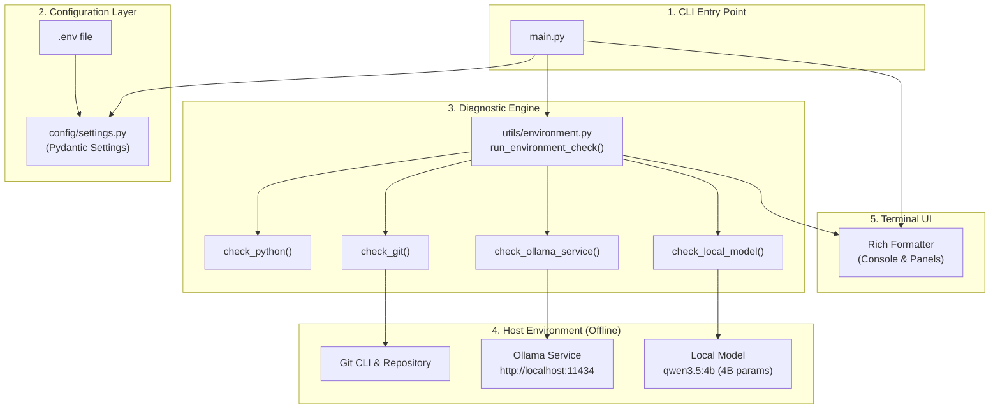

# Commit Surgeon - Step 1 Walkthrough & Architecture Guide

Welcome to the **Commit Surgeon** Step 1 technical walkthrough. This document provides an in-depth tour of the initial project setup, architectural foundations, module responsibilities, and instructions for verifying the environment.

---

## 1. Executive Summary

Commit Surgeon is an offline-first, AI-assisted Git management tool. Its long-term objective is to inspect tangled Git working trees, group logically related changes, suggest Conventional Commit messages, prompt for human approval, execute atomic commits, and generate Pull Request documentation—all powered by an open-source local LLM without external API dependencies.

> **Important Scope Clarification:**
> **Qwen3.5:4B (`qwen3.5:4b`)** is the intended local AI model for the complete application, but **Step 1 only verifies its presence and availability**. Actual AI-powered Git analysis, logical change grouping, commit message generation, and automated PR generation will be implemented in later stages (Steps 2 through 6).

### Implementation Status Breakdown

| Capability / Feature | Phase | Status | Description |
| :--- | :---: | :---: | :--- |
| **Project Foundation & Layout** | Step 1 | **Implemented** | Modular package hierarchy with PEP 8 standards |
| **Configuration Management** | Step 1 | **Implemented** | Pydantic Settings class with `.env` overrides |
| **Environment Diagnostics** | Step 1 | **Implemented** | Non-destructive checks for Python, Git, Ollama, and model |
| **Diagnostic Terminal CLI** | Step 1 | **Implemented** | Rich-powered environment status reporter and setup guides |
| **Automated Test Suite** | Step 1 | **Implemented** | 15 unit tests with external mocks running in < 1.0s |
| *Diff Parsing & Hunk Extraction* | Step 2 | *Planned* | Non-destructive working tree and staged diff inspection |
| *AI Change Grouping & Analysis* | Step 3 | *Planned* | Logical hunk clustering powered by local `qwen3.5:4b` |
| *Commit Message Generation* | Step 3 | *Planned* | Conventional Commit crafting using local inference |
| *Interactive Human Approval* | Step 4 | *Planned* | CLI review gate to inspect, edit, or reject commit plans |
| *Atomic Git Commit Execution* | Step 5 | *Planned* | Safe staging and discrete commit creation |
| *Pull Request Generation* | Step 6 | *Planned* | Consolidated PR markdown summary generation |

---

## 2. Architecture & Data Flow



---

## 3. Directory Structure & Module Responsibilities

```text
commit-surgeon/
│
├── main.py                 # Diagnostic CLI entry point
├── requirements.txt        # Initial dependencies (Pydantic, Rich, Pytest, etc.)
├── .gitignore              # Ignores virtualenvs, build files, caches, secrets
├── .env.example            # Documented environment configuration template
├── README.md               # Main project documentation
├── WALKTHROUGH.md          # Technical walkthrough and architectural guide
│
├── config/                 # Configuration management
│   ├── __init__.py         # Package exports
│   └── settings.py         # Pydantic Settings class loading from .env
│
├── git_engine/             # Git operations package (reserved for Step 2+)
│   └── __init__.py
│
├── ai_engine/              # LLM inference package (reserved for Step 3+)
│   └── __init__.py
│
├── approval/               # Interactive human approval flow (reserved for Step 4+)
│   └── __init__.py
│
├── utils/                  # Shared utilities and diagnostics
│   ├── __init__.py         # Package exports
│   └── environment.py      # Non-destructive environment checks
│
├── output/                 # Storage for generated PR and commit plans
│   └── .gitkeep
│
└── tests/                  # Pytest test suite
    ├── __init__.py
    ├── test_cli.py         # CLI startup and output verification
    ├── test_config.py      # Configuration defaults and override tests
    └── test_environment.py # Mock-based environment diagnostics tests
```

---

## 4. Component Deep Dives

### A. Configuration Management: `config/settings.py`
- Built on **Pydantic v2** (`BaseModel`) for type validation.
- Automatically reads `.env` variables via `python-dotenv`.
- Exposes typed fields with fallback defaults:
  - `app_name`: `"Commit Surgeon"`
  - `app_version`: `"0.1.0"`
  - `ollama_api_url`: `"http://localhost:11434"`
  - `default_model`: `"qwen3.5:4b"` (4B parameter budget)
  - `model_timeout`: `60` seconds
  - `max_diff_size`: `100000` characters
  - `debug`: `False`

### B. Environment Diagnostics: `utils/environment.py`
Provides safe, read-only system inspection:
- `check_python()`: Confirms Python runtime version is 3.10+ (current system: Python 3.13.7).
- `check_git()`: Verifies `git` binary availability in `PATH` and confirms worktree status. Runs in non-modifying mode during CLI checks.
- `check_ollama_service()`: Queries `GET /api/tags` with a short 3-second timeout. Gracefully handles connection failures when Ollama is offline.
- `check_local_model()`: Checks if the target model (`qwen3.5:4b`) exists in the local Ollama catalog. If Ollama is not running, reports status as `Unknown` rather than `Not Available` and provides manual setup commands without auto-downloading.

### C. Terminal CLI: `main.py`
- Formatted with **Rich** for readability and visual distinction.
- Prints exact environment statuses:
  - `- Python: Installed`
  - `- Git: Installed`
  - `- Ollama: Running / Not Running`
  - `- Local Model: Available / Not Available / Unknown`
- Accurately conveys project readiness (`(Ready)` vs `(Setup Required)`) without claiming complete readiness when dependencies are missing.
- Renders an informative `Action Required / Recommendations` panel when local services or models are missing.

### D. Automated Test Suite: `tests/`
All 15 tests run in **< 1.0 second** and do not require internet access, live Git operations, or a running Ollama daemon:
- **`tests/test_config.py`**: Tests default configurations, custom kwargs instantiation, and environment variable overrides via `monkeypatch`.
- **`tests/test_environment.py`**: Tests Python version checks, Git presence/absence, Ollama reachable/unreachable states, and model presence/absence with mock payloads.
- **`tests/test_cli.py`**: Tests CLI return codes and console captures across offline and ready states.

---

## 5. Step-by-Step Verification Guide

Follow these commands in your terminal to verify the environment.

### 1. Activate the Virtual Environment

**Windows PowerShell:**
```powershell
.\.venv\Scripts\Activate.ps1
```

**Windows CMD:**
```cmd
.\.venv\Scripts\activate.bat
```

**macOS / Linux:**
```bash
source .venv/bin/activate
```

---

### 2. Run the Main Diagnostic Application

```powershell
.\.venv\Scripts\python main.py
```

**Observed Terminal Output:**
```text
COMMIT SURGEON
AI-powered offline Git commit management

Version: 0.1.0

Environment Status:
- Python: Installed
- Git: Installed
- Ollama: Not Running
- Local Model: Unknown

Project Status: Environment Check Complete (Setup Required)

+--------------------- Action Required / Recommendations ---------------------+
| Ollama Service:                                                             |
|   Ollama is not running. Start the service with:                            |
|     ollama serve                                                            |
|   Or launch the Ollama desktop application.                                 |
|                                                                             |
| Local Model (qwen3.5:4b):                                                   |
|   Model availability is currently unknown because Ollama is not running.    |
|   qwen3.5:4b is a 4-billion (4B) parameter model designed for fast,         |
| lightweight, offline inference.                                             |
|   Once Ollama is started, download and verify the model with:               |
|     ollama pull qwen3.5:4b                                                  |
|   Commit Surgeon will not automatically download models to respect your     |
| bandwidth and offline workflow.                                             |
+-----------------------------------------------------------------------------+
```

---

### 3. Run the Automated Test Suite

```powershell
.\.venv\Scripts\pytest -v
```

**Test Execution Summary:**
```text
tests/test_cli.py::test_cli_startup_with_missing_ollama PASSED           [  6%]
tests/test_cli.py::test_cli_startup_all_ready PASSED                     [ 13%]
tests/test_config.py::test_default_settings_values PASSED                [ 20%]
tests/test_config.py::test_custom_settings_instantiation PASSED          [ 26%]
tests/test_config.py::test_settings_load_from_environment PASSED         [ 33%]
tests/test_environment.py::test_check_python PASSED                      [ 40%]
tests/test_environment.py::test_check_git_installed PASSED               [ 46%]
tests/test_environment.py::test_check_git_missing PASSED                 [ 53%]
tests/test_environment.py::test_check_ollama_service_running PASSED      [ 60%]
tests/test_environment.py::test_check_ollama_service_not_running PASSED  [ 66%]
tests/test_environment.py::test_check_local_model_when_ollama_not_running PASSED [ 73%]
tests/test_environment.py::test_check_local_model_available PASSED       [ 80%]
tests/test_environment.py::test_check_local_model_missing PASSED         [ 86%]
tests/test_environment.py::test_check_local_model_query_error PASSED     [ 93%]
tests/test_environment.py::test_run_environment_check_all_ready PASSED   [100%]

============================= 15 passed in 0.83s ==============================
```

---

## 6. Development Principles & Guardrails

1. **Offline-First:** No calls to remote LLM APIs (OpenAI, Anthropic, Gemini, etc.). All inference stays on the user's machine through Ollama.
2. **Non-Destructive:** The CLI performs read-only checks during diagnostics and never modifies the user's working tree or repository without explicit confirmation.
3. **User-Controlled Model Management:** No background downloading of multi-gigabyte models; clear instructions are presented for manual pulls.
4. **Clean Decoupling:** Packages (`git_engine`, `ai_engine`, `approval`, `utils`, `config`) remain independent to facilitate unit testing and Step-by-Step enhancement.

---

## 7. Next Step: Step 2 Preview

In **Step 2**, we will implement the `git_engine` layer:
- Diff extraction (`git diff` and `git diff --cached`)
- Patch and hunk parsing
- Working tree status analysis
- Token/size limit validation against `max_diff_size`
