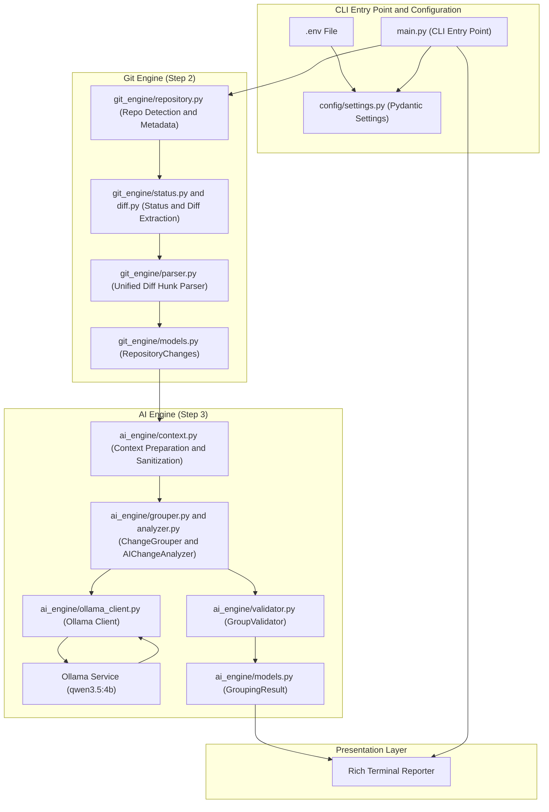

# Commit Surgeon – Technical Walkthrough & Architecture Guide

Welcome to the **Commit Surgeon** technical walkthrough and architecture guide. This document provides an in-depth tour of the project architecture, implemented modules, data models, verification procedures, and roadmap across **Steps 1, 2, and 3**.

---

## 1. Executive Summary

Commit Surgeon is an offline-first, AI-assisted Git management tool. Its long-term objective is to inspect tangled Git working trees, group logically related changes into atomic units, suggest Conventional Commit messages, prompt for human approval, execute safe commits, and generate Pull Request documentation—all powered by an open-source local LLM without external API dependencies.

> **Scope & Implementation Clarification:**
> The local AI model **Qwen3.5:4B (`qwen3.5:4b`)** is actively integrated via Ollama for local AI inference and semantic change grouping.
>
> - **Step 1:** Project foundation, Pydantic configuration, environment diagnostics – **Complete**.
> - **Step 2:** Git integration, status extraction, diff extraction, hunk parsing, and source attribution – **Complete**.
> - **Step 3:** AI-powered change analysis, context sanitization, semantic grouping, and group validation – **Complete**.
> - **Step 4:** Interactive human approval and commit-plan editing – *Planned*.
> - **Step 5:** Safe staging and atomic Git commit execution – *Planned*.
> - **Step 6:** Consolidated Pull Request markdown generation – *Planned*.

### Implementation Status Breakdown

| Capability / Feature | Phase | Status | Description |
| :--- | :---: | :---: | :--- |
| **Project Foundation & Layout** | Step 1 | **Implemented** | Modular package hierarchy with PEP 8 standards |
| **Configuration Management** | Step 1 | **Implemented** | Pydantic Settings class with `.env` overrides and model parameters |
| **Environment Diagnostics** | Step 1 | **Implemented** | Non-destructive checks for Python, Git, Ollama daemon, and local model |
| **Diagnostic Terminal CLI** | Step 1 | **Implemented** | Rich-powered environment status reporter and setup recommendations |
| **Git Repository Detection** | Step 2 | **Implemented** | Non-destructive repo root, branch, commit, and detached HEAD detection |
| **Git Status Extraction** | Step 2 | **Implemented** | Machine-readable `-z` porcelain status parser handling renames and conflicts |
| **Diff Extraction & Hunk Parsing**| Step 2 | **Implemented** | Unified diff extraction for staged, unstaged, and untracked changes |
| **Hunk Source Attribution** | Step 2 | **Implemented** | Granular attribution preserving `staged`, `unstaged`, and `untracked` origins |
| **Ollama Local LLM Client** | Step 3 | **Implemented** | HTTP chat client with structured JSON parsing, timeouts, and duration tracking |
| **Change Context Sanitization** | Step 3 | **Implemented** | Context builder with sensitive file filtering and prompt-injection precautions |
| **AI Change Analysis & Grouping**| Step 3 | **Implemented** | Semantic change clustering using local `qwen3.5:4b` with hunk-level granularity |
| **Group Invariant Validation** | Step 3 | **Implemented** | Strict validator checking coverage, uniqueness, confidence, and source integrity |
| **Automated Test Suite** | Steps 1–3 | **Implemented** | 143 automated unit and integration tests passing in ~27s |
| *Interactive Human Approval* | Step 4 | *Planned* | CLI review gate to inspect, edit, or reject commit plans |
| *Safe Git Commit Execution* | Step 5 | *Planned* | Discrete staging and atomic commit execution |
| *Pull Request Generation* | Step 6 | *Planned* | Consolidated PR markdown summary generation |

---

## 2. Architecture & Data Flow



---

## 3. Directory Structure & Module Responsibilities

The project is structured into modular, decoupled packages:

```text
commit-surgeon/
│
├── main.py                     # CLI entry point (env check, analyze, group)
├── requirements.txt            # Runtime and testing dependencies
├── .gitignore                  # Virtualenvs, caches, test artifacts, secrets
├── .env.example                # Configuration template
├── README.md                   # Main project overview
├── WALKTHROUGH.md              # Technical walkthrough and architectural guide
│
├── config/                     # Configuration management
│   ├── __init__.py             # Package exports
│   └── settings.py             # Pydantic Settings class loading from .env
│
├── utils/                      # Shared diagnostics and utilities
│   ├── __init__.py             # Package exports
│   └── environment.py          # Non-destructive environment checks
│
├── git_engine/                 # Git integration and change extraction (Step 2)
│   ├── __init__.py             # Re-exports public symbols
│   ├── exceptions.py           # Typed Git exception hierarchy
│   ├── models.py               # Pydantic models (RepositoryInfo, DiffHunk, FileChange, RepositoryChanges)
│   ├── repository.py           # Repository metadata and detection
│   ├── status.py               # Machine-readable porcelain status parsing
│   ├── diff.py                 # Staged, unstaged, and untracked diff extraction
│   ├── parser.py               # Unified diff hunk parser
│   └── analyzer.py             # Coordinator combining status and diffs
│
├── ai_engine/                  # Local LLM inference and grouping (Step 3)
│   ├── __init__.py             # Re-exports public symbols
│   ├── exceptions.py           # Typed AI engine exception hierarchy
│   ├── models.py               # Pydantic models (ChangeAnalysis, ProposedCommitGroup, GroupingResult)
│   ├── ollama_client.py        # Ollama HTTP chat client with duration tracking
│   ├── context.py              # Change context preparation and sensitive file filtering
│   ├── prompts.py              # System prompts, injection defense, and repair prompts
│   ├── validator.py            # Strict invariant validation (coverage, uniqueness, bounds)
│   ├── analyzer.py             # LLM analysis coordinator with single-cycle repair
│   └── grouper.py              # High-level coordinator turning RepositoryChanges into GroupingResult
│
├── approval/                   # Interactive human approval flow (Reserved for Step 4)
│   └── __init__.py
│
├── output/                     # Storage for generated PR and commit plans
│   └── .gitkeep
│
├── commit-surgeon-audit/        # Development-only manual test fixture (keep outside production releases)
│   └── auth.py
│
└── tests/                      # Automated pytest test suite (143 tests across 14 test modules)
    ├── __init__.py
    ├── conftest.py             # Shared fixtures (temp_git_repo, repo_with_initial_commit)
    ├── test_config.py          # Configuration defaults and override tests
    ├── test_environment.py     # Environment diagnostics tests
    ├── test_git_repository.py  # Git repository inspection tests
    ├── test_git_status.py      # Porcelain status parsing tests
    ├── test_git_diff.py        # Diff extraction tests
    ├── test_git_parser.py      # Hunk parser tests
    ├── test_hunk_separation.py  # Staged vs unstaged regression tests
    ├── test_ollama_client.py   # Ollama client mock tests
    ├── test_ai_models.py       # AI Pydantic model validation tests
    ├── test_group_validator.py # Group validation invariant tests
    ├── test_ai_analyzer.py     # AI analyzer inference and repair tests
    ├── test_change_grouper.py  # Semantic grouping tests
    └── test_cli.py             # CLI commands tests (diagnostics, analyze, group)
```

---

## 4. Step 1: Foundation, Configuration & Environment Diagnostics

Step 1 established the project baseline: configuration management, environment validation, and CLI diagnostics.

### A. Configuration Management: `config/settings.py`
- Built on **Pydantic v2** (`BaseModel`) for strict typing.
- Reads `.env` variables via `python-dotenv`.
- Configurable settings:
  - `app_name`: `"Commit Surgeon"`
  - `app_version`: `"0.1.0"`
  - `ollama_api_url`: `"http://localhost:11434"`
  - `default_model`: `"qwen3.5:4b"` (4B parameter budget)
  - `model_timeout`: `60` seconds (default in codebase; configurable via `MODEL_TIMEOUT`. A setting of `120`–`180` seconds is recommended for cold starts)
  - `max_diff_size`: `100000` characters (diff limit before truncation warning)
  - `max_context_size`: `50000` characters (LLM context limit)
  - `ai_temperature`: `0.1` (conservative sampling for reproducible grouping)
  - `debug`: `False`

### B. Environment Diagnostics: `utils/environment.py`
Provides safe, read-only system inspection:
- `check_python()`: Confirms Python runtime version is 3.10+ (current system: Python 3.13.7).
- `check_git()`: Verifies `git` binary availability in `PATH`.
- `check_ollama_service()`: Queries `GET /api/tags` with a 3-second timeout.
- `check_local_model()`: Checks whether `qwen3.5:4b` exists in the local Ollama catalog. If Ollama is offline, reports status as `Unknown` rather than `Not Available` and provides setup instructions without auto-downloading.

### C. Historical Milestone: Original Step 1 Verification Output
When Step 1 was completed, running `python main.py` produced the following baseline report:

```text
COMMIT SURGEON
AI-powered offline Git commit management

Version: 0.1.0

Environment Status:
- Python: Installed
- Git: Installed
- Ollama: Not Running
- Local Model: Unknown

Project Status: Environment Check Complete (Setup Required)

+--------------------- Action Required / Recommendations ---------------------+
| Ollama Service:                                                             |
|   Ollama is not running. Start the service with:                            |
|     ollama serve                                                            |
|   Or launch the Ollama desktop application.                                 |
|                                                                             |
| Local Model (qwen3.5:4b):                                                   |
|   Model availability is currently unknown because Ollama is not running.    |
|   qwen3.5:4b is a 4-billion (4B) parameter model designed for fast,         |
| lightweight, offline inference.                                             |
|   Once Ollama is started, download and verify the model with:               |
|     ollama pull qwen3.5:4b                                                  |
|   Commit Surgeon will not automatically download models to respect your     |
| bandwidth and offline workflow.                                             |
+-----------------------------------------------------------------------------+
```

*(Note: In the active environment, the Ollama service is running and `qwen3.5:4b` is available).*

### D. Historical Milestone: Step 1 Automated Test Suite
The original Step 1 test suite verified configuration defaults, overrides, environment checks, and basic CLI startup:

```text
============================= 15 passed in 0.83s ==============================
```

---

## 5. Step 2: Git Integration & Change Extraction

> **Safety Guarantee:** Step 2 is purely diagnostic and read-only. It **never** invokes `git add`, `git commit`, `git reset`, `git checkout`, `git clean`, or `git push`. Files are inspected read-only.

### A. Repository Detection: `git_engine/repository.py`
- `is_git_repository(path)`: Detects whether directory belongs to a Git repo.
- `get_repository_root(path)`: Resolves absolute root via `rev-parse --show-toplevel`.
- `get_git_version()`: Returns installed Git version string.
- `get_current_branch(path)`: Returns active branch or `None` if detached/unborn.
- `get_current_commit(path)`: Returns HEAD commit SHA-1 or `None` if empty.
- `is_detached_head(path)`: Detects detached HEAD state via `symbolic-ref -q HEAD`.
- All operations use `subprocess.run()` with explicit argument lists; `shell=True` is forbidden.

### B. Git Status Detection: `git_engine/status.py`
Uses `git status --porcelain=v1 -z --untracked-files=all`. The null-delimited format safely handles filenames containing spaces, unicode, quotes, and newlines.

Accurately distinguishes:
- Modified (staged vs. unstaged)
- Added (staged new files)
- Deleted (staged vs. unstaged)
- Renamed / Copied (preserves both old and new paths)
- Untracked files
- Conflicted files (`UU`, `AA`, `AU`, `UD`, etc.)

### C. Diff Extraction: `git_engine/diff.py`
- Unstaged diffs: `git diff --no-ext-diff --no-color --no-renames`
- Staged diffs: `git diff --cached --no-ext-diff --no-color --no-renames`
- Combined tracked diffs: `git diff HEAD ...`
- Untracked files: Safely synthesizes unified diffs without modifying the index.
- Size limit: When total diff characters exceed `Settings.max_diff_size` (100,000 chars), extraction halts and `is_truncated = True` is flagged.
- Binary detection: Scans the first 8 KB for null bytes (`\x00`) to avoid processing binary data.

### D. Unified Diff Hunk Parser: `git_engine/parser.py`
Parses raw unified diffs into structured `DiffHunk` and `FileChange` objects.
Hunk headers (`@@ -old_s,old_c +new_s,new_c @@`) are parsed into start and count coordinates, and added/deleted lines are calculated per hunk.

### E. Structured Data Models: `git_engine/models.py`

#### `DiffHunk`
```python
class DiffHunk(BaseModel):
    hunk_id: str                          # Unique identifier (e.g. hunk_1_staged_auth.py)
    source_state: str = "unstaged"        # Origin: 'staged', 'unstaged', or 'untracked'
    old_start: int = 0                    # Line start in original file
    old_count: int = 0                    # Line count in original file
    new_start: int = 0                    # Line start in new file
    new_count: int = 0                    # Line count in new file
    header: str = ""                      # Unified diff header (@@ ... @@)
    content: str = ""                     # Full text of hunk including prefixes (+/-)
    added_lines: int = 0                  # Added lines count in this hunk
    deleted_lines: int = 0                # Deleted lines count in this hunk
```
Properties: `is_staged`, `is_unstaged`, `is_untracked`, `source`.

#### `FileChange`
Represents modifications detected in a single file:
- `file_path`, `old_path`, `new_path`, `change_type`
- `is_staged`, `is_unstaged`, `is_untracked`, `is_binary`
- `added_lines`, `deleted_lines` (aggregate)
- `staged_added_lines`, `staged_deleted_lines`
- `unstaged_added_lines`, `unstaged_deleted_lines`
- `hunks: List[DiffHunk]`
- Properties: `staged_hunks`, `unstaged_hunks`

#### `RepositoryChanges`
Consolidated report across working tree and index:
- `repository: RepositoryInfo`
- `changes: List[FileChange]`
- `total_files: int`
- `total_added_lines`, `total_deleted_lines`, `total_hunks` (aggregate)
- `staged_added_lines`, `staged_deleted_lines`, `staged_hunks`
- `unstaged_added_lines`, `unstaged_deleted_lines`, `unstaged_hunks`
- `has_conflicts: bool`, `has_truncated_content: bool`
- Methods: `get_staged_hunks()`, `get_unstaged_hunks()`

### F. CLI: `analyze` Command
Usage:
```powershell
python main.py analyze [repository_path]
```

Output on `commit-surgeon-audit`:
```text
COMMIT SURGEON
Git Change Analysis

Repository: commit-surgeon-audit
Branch: master

Detected Changes:

Modified: 1
Added: 0
Deleted: 0
Renamed: 0
Untracked: 0

Diff Statistics:

Staged:
- Added lines: 2
- Deleted lines: 2

Unstaged:
- Added lines: 3
- Deleted lines: 0

Total:
- Added lines: 5
- Deleted lines: 2
- Hunks: 2

Analysis completed successfully.
```

### G. Historical Milestone: Step 2 Test Results
- Initial Step 2 test suite: 78 tests across repository, status, diff, and parser modules.
- Step 2 hunk separation regression suite: 10 tests verifying that `DiffHunk.source_state`, `FileChange`, and `RepositoryChanges` maintain separate staged and unstaged statistics.
- Total Step 2 tests: **88 tests** (cumulative project total at Step 2 was 103 tests including Step 1).

---

## 6. Step 3: AI-Powered Change Analysis & Logical Grouping

> **Safety Guarantee:** Step 3 is read-only. It performs semantic analysis and proposes commit groups, but **does not create commits or stage files**.

### A. Ollama Integration: `ai_engine/ollama_client.py`
- Communicates directly with the local Ollama REST API at `http://localhost:11434`.
- Uses `POST /api/chat` with `stream=false` and `format="json"`.
- Requests `qwen3.5:4b` using conservative sampling (`temperature=0.1`).
- Accurately measures inference execution time using `time.perf_counter()`.
- Error mapping:
  - `OllamaConnectionError`: Daemon not reachable.
  - `OllamaTimeoutError`: Inference exceeds `Settings.model_timeout` (codebase default: 60s). Because cold-start loading from disk can take 50–60s on local hardware, a configured timeout of **120–180 seconds** via `MODEL_TIMEOUT` in `.env` is strongly recommended for initial runs. The codebase default remains 60 seconds unless explicitly overridden.
  - `OllamaModelNotFoundError`: Requested model missing in Ollama catalog.
  - `OllamaResponseError`: Malformed response, empty body, or server error.

### B. Change Context Preparation & Security: `ai_engine/context.py`
Converts `RepositoryChanges` into discrete, compact `ChangeContextItem` objects.

#### 1. Sensitive File Filtering
- Filters files matching sensitive patterns (`.env`, `.env.*`, `*.key`, `*.pem`, `id_rsa`, `credentials.json`, `client_secret.json`, `secrets.yml`, `wp-config.php`).
- Excluded files are omitted from the LLM prompt and reported in `PreparedChangeContext.excluded_files`.
- **Security Note:** Filename-based filtering does *not* guarantee detection of secrets (such as hardcoded API keys or passwords) embedded inside ordinary source files. Content-based secret scanning is not currently implemented.

#### 2. Prompt Injection Precautions
- Diff content is isolated within `<untrusted_diff_data>` XML-style delimiters.
- The system prompt explicitly instructs the model that all text inside `<untrusted_diff_data>` is untrusted source-code modifications and must never be interpreted as instructions.
- **Security Note:** Delimiters and prompt directives are defensive precautions, not an impenetrable security boundary against sophisticated prompt injection.

#### 3. Context Size Enforcement
- Enforces `Settings.max_context_size` (default 50,000 characters).
- If context exceeds this limit, or if the Git analyzer previously encountered truncation, `ContextExceededLimitError` is raised to prevent partial or hallucinated analysis. Changes are never silently discarded.

### C. Hunk-Level Semantic Grouping: `ai_engine/grouper.py` & `ai_engine/analyzer.py`
The AI engine groups changes based on semantic intent rather than file boundaries:
- **Cross-File Cohesion:** Different files contributing to the same logical feature (e.g. `auth.py`, `middleware.py`, `test_auth.py`) are grouped together.
- **Hunk-Level Granularity:** Different hunks in the *same* file can be split across different commit groups if they serve different purposes (e.g. a bug fix vs. a logging addition).
- **Independent Changes:** Standalone modifications form their own atomic groups.
- **Uncertainty Representation:** If the relationship between changes cannot be determined with confidence, they are placed in `ungrouped_changes` or assigned lower confidence (< 0.7) with `uncertainty_flags`.

### D. Structured AI Data Models: `ai_engine/models.py`

#### `ChangeAnalysis`
Semantic evaluation of an individual change unit:
- `change_id`: Identifier of the hunk or change unit.
- `file_path`: Path to the affected file.
- `source_state`: `'staged'`, `'unstaged'`, or `'untracked'`.
- `summary`: Concise description of what changed.
- `purpose`: Observed intent of the modification.
- `affected_functionality`: Subsystem or component affected.
- `confidence`: Float between `0.0` and `1.0`.
- `uncertainty_reason`: Optional explanation if confidence is low.

#### `ProposedCommitGroup`
A proposed atomic commit:
- `group_id`: Unique identifier (e.g. `'group_1'`).
- `suggested_title`: Conventional Commit message title (e.g. `fix(auth): ...`).
- `summary`: Detailed description of the group's cohesive purpose.
- `change_ids`: List of exact change IDs included.
- `reasoning`: Justification for grouping these modifications together.
- `confidence`: Float between `0.0` and `1.0`.
- `uncertainty_flags`: List of warning flags if relationships are tentative.

#### `GroupingResult`
Consolidated LLM output:
- `analysis_summary`: High-level overview of detected modifications.
- `change_analyses`: List of `ChangeAnalysis` items.
- `proposed_groups`: List of `ProposedCommitGroup` items.
- `ungrouped_changes`: List of change IDs that could not be grouped.
- `warnings`: Warning messages.
- `requires_manual_review`: Boolean flag indicating whether low confidence or truncation necessitates human review.
- `model_name`: Name of model used (`"qwen3.5:4b"`).
- `inference_duration_seconds`: Wall-clock execution time.

> **Critical Understanding of Confidence Scores:**
> Model-generated confidence scores are subjective, self-reported heuristic estimates produced by the LLM during generation, **not** statistically calibrated Bayesian probabilities or mathematical guarantees of correctness. They serve purely as relative indicators to help prioritize inspection or flag ambiguous groupings for manual review (`requires_manual_review = True`). **They must never replace human developer review**, which will be formally enforced in Step 4's interactive approval gate.

### E. Group Validation & Repair: `ai_engine/validator.py`
Model output is never trusted blindly. `GroupValidator` enforces the following distinct invariants:

1. **Empty Group Prevention:** Rejects any group containing zero change IDs (`EmptyGroupError`).
2. **Group Confidence Bounds:** Rejects group confidence scores outside `[0.0, 1.0]` (`InvalidConfidenceError`).
3. **Unknown Change ID Detection:** Rejects change IDs referenced in groups or ungrouped lists that were absent from the input context (`UnknownChangeIdError`).
4. **Duplicate Change ID Detection:** Rejects change IDs appearing in multiple groups or simultaneously in a group and `ungrouped_changes` (`DuplicateChangeError`).
5. **Complete Change Coverage:** Ensures every input change ID is accounted for exactly once across proposed groups and `ungrouped_changes` (`MissingChangeIdError`).
6. **ChangeAnalysis Confidence Bounds:** Rejects individual change confidence scores outside `[0.0, 1.0]` (`InvalidConfidenceError`).
7. **Source-State Preservation:** Verifies that each change analysis retains its original `staged`, `unstaged`, or `untracked` attribution (`SourceStateMismatchError`).
8. **Context Truncation & Low-Confidence Review Flagging:** Flags truncated inputs or groups with confidence < 0.7 for manual review.

#### Controlled Repair Cycle
If JSON parsing fails or invariant validation raises an error, `AIChangeAnalyzer` executes **at most one** targeted repair prompt containing the specific validation failure. If the second attempt fails, `AIAnalysisError` is raised. The system never loops indefinitely or fabricates valid output.

### F. CLI Usage: `group` Command
Usage:
```powershell
python main.py group [repository_path]
```

Workflow:
1. Verifies Ollama is running (`OllamaClient.is_service_running()`).
2. Verifies `qwen3.5:4b` is present in local Ollama catalog (`is_model_available()`).
3. Runs the Git engine analyzer to extract repository changes.
4. Prepares sanitized change context.
5. Invokes local LLM inference.
6. Validates the response against all invariants.
7. Renders proposed commit groups via Rich.

#### Real Model Inference Example
Tested live against `commit-surgeon-audit` using local `qwen3.5:4b`:

> **Development Test Fixture Note:** The `commit-surgeon-audit` directory is a manual, development-only test repository created specifically to test multi-hunk separation on disk. It should be kept outside the production project tree or excluded from release distributions.

```text
COMMIT SURGEON
AI Change Grouping

Repository: commit-surgeon-audit
Model: qwen3.5:4b

Proposed Commit Groups:

Group 1: fix(auth): correct login/logout return values

Files:
- auth.py

Reason:
This change modifies existing authentication functions (login, logout) to fix 
their return value semantics from False to True, representing a bug fix in 
authentication behavior.

Confidence: 0.95

--------------------------------

Group 2: feat(auth): add validate_user function

Files:
- auth.py

Reason:
This change introduces a completely new function (validate_user) that was not 
present before, representing feature addition rather than bug fix.

Confidence: 0.95

Analysis completed.
```

**Underlying Hunk Attribution in this Result:**
- **Group 1** contains `hunk_1_staged_auth.py` (`source_state: staged`, lines +2, -2).
- **Group 2** contains `hunk_1_unstaged_auth.py` (`source_state: unstaged`, lines +3, -0).
- The model successfully separated two hunks in the same file into distinct bug fix (`fix`) and feature (`feat`) commits with 0.95 confidence.

### G. Performance & Hardware Benchmarks
- **Target Constraint:** The tool is designed around an 8 GB RAM target constraint. Formal benchmarking on constrained 8 GB physical hardware remains pending.
- **Initial Local Benchmark Measurements (NVIDIA RTX GPU host):**
  - **Memory Footprint:** Ollama reported **3.1 GB** allocated to dedicated GPU VRAM (with `100% GPU` layer offload in `llamacpp` on the host NVIDIA RTX GPU). This 3.1 GB figure reflects GPU VRAM allocation, not CPU system RAM. CPU-only execution will have a different memory footprint due to differing runtime buffers, context allocations, and quantization handling. CPU-only system RAM usage requires separate benchmarking on dedicated non-GPU hardware.
  - **Cold Start:** 50–60 seconds for initial model load from disk into GPU memory. Because this measured cold start approaches the default 60-second request timeout (`model_timeout`), configuring `MODEL_TIMEOUT=120` or `180` in `.env` is strongly recommended for initial runs.
  - **Warm Inference:** **8.4 seconds** execution time for the 2-hunk audit repository once loaded in VRAM.

---

## 7. Consolidated Testing Summary

The test suite runs entirely offline with mocked HTTP requests for unit testing. No network calls or model downloads are executed during standard test runs.

```powershell
pytest -v
```

### Breakdown Across Phases:

| Phase | Test File | Tests | Focus Area |
| :--- | :--- | :---: | :--- |
| **Step 1** | `test_config.py` | 3 | Configuration defaults, environment overrides |
| **Step 1** | `test_environment.py` | 10 | Python, Git, Ollama status, model checks |
| **Step 1** | `test_cli.py` (Step 1 tests) | 2 | Startup display, missing Ollama diagnostic |
| **Step 2** | `test_git_repository.py` | 20 | Repository root, branch, commit, detached HEAD |
| **Step 2** | `test_git_status.py` | 21 | Machine-readable porcelain status parsing |
| **Step 2** | `test_git_diff.py` | 20 | Staged, unstaged, untracked, binary diffs |
| **Step 2** | `test_git_parser.py` | 17 | Unified diff hunk header and content parsing |
| **Step 2** | `test_hunk_separation.py` | 10 | Hunk source attribution regression tests |
| **Step 3** | `test_ollama_client.py` | 12 | Ollama HTTP client, timeouts, error mapping |
| **Step 3** | `test_ai_models.py` | 8 | AI models validation, sensitive file detection |
| **Step 3** | `test_group_validator.py` | 8 | Invariant validation (coverage, uniqueness, bounds) |
| **Step 3** | `test_ai_analyzer.py` | 7 | Inference orchestration, code-fence cleaning, repair |
| **Step 3** | `test_change_grouper.py` | 2 | Cross-file and same-file different-hunk grouping |
| **Step 3** | `test_cli.py` (Step 3 tests) | 3 | Group CLI offline handling, missing model, display |
| **Total** | **14 test modules** | **143** | **Full Project Test Suite** |

*Note: The 14 entries in the table correspond to the 13 distinct `test_*.py` files (with `test_cli.py` tested across Steps 1 and 3) plus `conftest.py` in the `tests/` directory, confirming a verified project total of **143 passing tests**.*

### Verified Test Suite Result:
```text
============================ 143 passed in 26.99s =============================
```

---

## 8. Development Roadmap

Commit Surgeon is developed in sequential steps:

- **Step 1: Foundation, Configuration & Diagnostics** – **Complete**
- **Step 2: Git Integration & Change Extraction** – **Complete**
- **Step 3: AI-Powered Change Analysis & Logical Grouping** – **Complete**
- **Step 4: Interactive Human Approval Gate** – *Planned*
  - CLI review interface allowing developers to inspect, edit, split, re-title, or reject proposed commit groups before execution.
- **Step 5: Safe Git Commit Execution** – *Planned*
  - Non-destructive patch staging using `git apply --cached` and atomic execution of approved commits.
- **Step 6: Consolidated Pull Request Documentation** – *Planned*
  - Automated PR summary generation aggregating all commits into structured Markdown for GitHub/GitLab.
